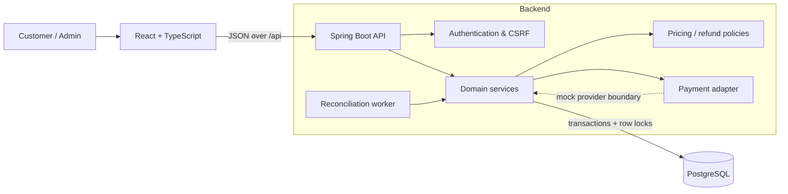
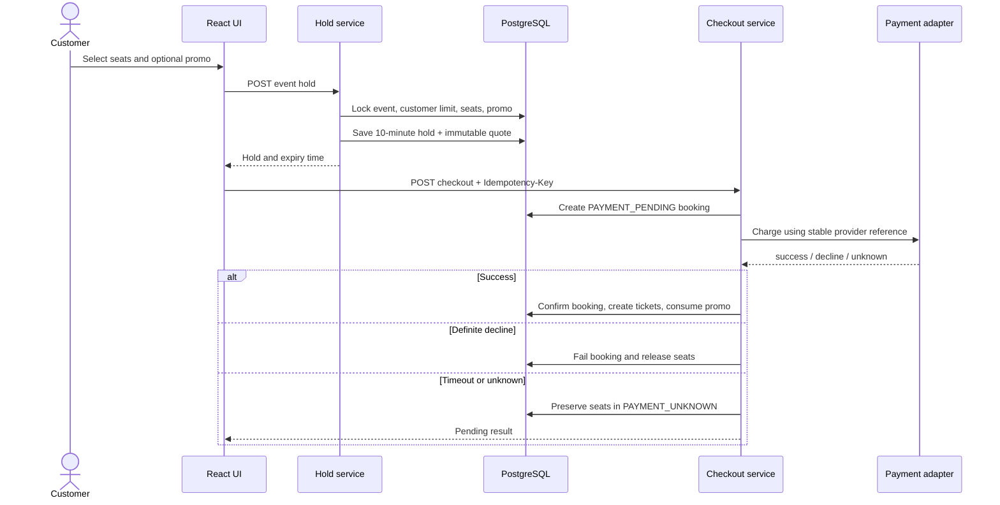
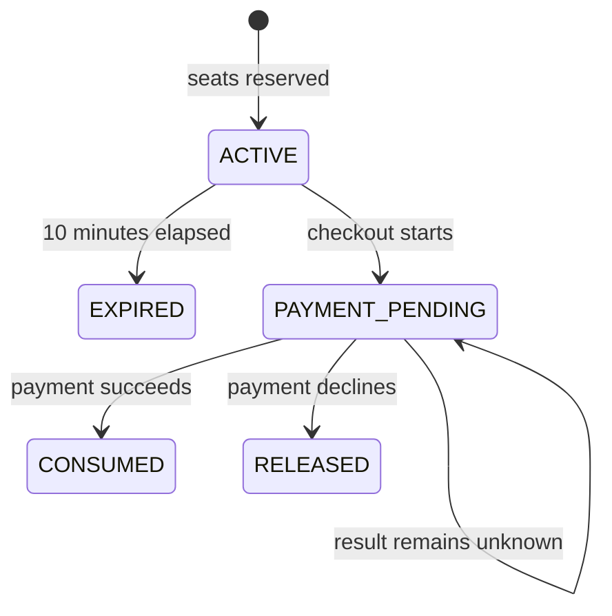
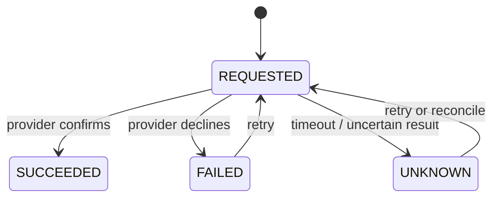
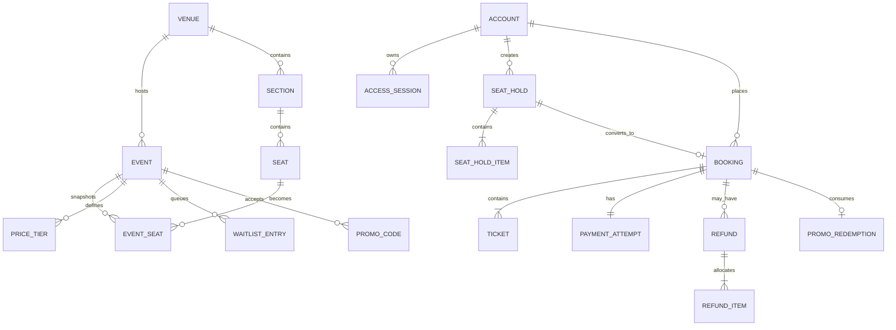
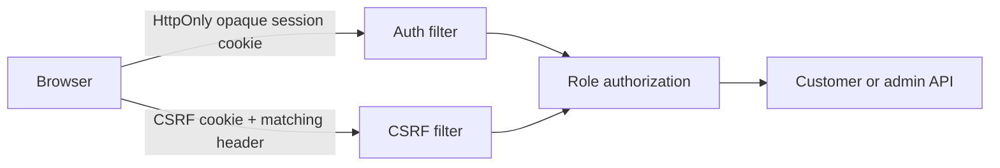
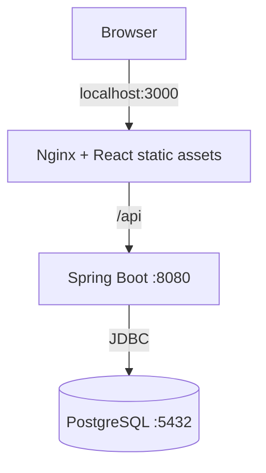

# Lockstep Tickets — System Design

> A correctness-first, assigned-seat ticketing system. The main design goal is
> simple: **a seat must never be sold twice**, even when requests race or a
> payment result is uncertain.

## 1. Design at a glance



The application is a modular monolith. React renders the customer and admin
portals. Spring Boot owns business rules and authorization. PostgreSQL is the
source of truth for inventory, money, limits, and workflow state.

### Why this shape?

- One backend and one database keep multi-row booking transactions atomic.
- Domain packages keep the monolith understandable without distributed-system
  overhead.
- PostgreSQL locks and constraints protect correctness across multiple server
  threads or future backend replicas.
- Payment calls remain behind an adapter so a real provider can replace the
  mock implementation later.

## 2. Main building blocks

| Area | Responsibility | Important code |
|---|---|---|
| Web UI | Event discovery, seat selection, checkout, bookings, refunds, waitlist, admin tools | `frontend/src/CustomerPortal.tsx`, `AdminPortal.tsx` |
| Catalog | Search events and show a seat map with current availability | `catalog/` |
| Holds | Atomically reserve 1–6 seats for 10 minutes and snapshot their quote | `hold/` |
| Checkout | Idempotent payment, booking confirmation, and uncertain-result recovery | `checkout/` |
| Pricing | Integer-only early-bird, group, promo, and service-fee calculations | `pricing/` |
| Refunds | Policy calculation, exact allocation, retries, and reconciliation | `refund/` |
| Waitlist | FIFO entry, 15-minute offers, and offer claims | `waitlist/` |
| Administration | Seat overrides, event cancellation/reschedule, exceptional refunds, audit | `admin/` |
| Reports | Sales and occupancy computed from transactional records | `report/` |
| Identity | Login throttling, opaque sessions, role checks, and CSRF protection | `auth/`, `config/` |

Controllers translate HTTP requests. Services enforce workflows and transaction
boundaries. JDBC repositories issue explicit SQL and locks. This separation
keeps transport details out of business decisions.

## 3. The booking journey



The quote is calculated when the hold is created and copied into the booking
and tickets. Later price changes therefore cannot rewrite a customer's agreed
price or historical reports.

## 4. Concurrency model

### Invariants

1. An event seat has at most one active owner: a hold, waitlist offer, pending
   payment, or active ticket.
2. A hold contains 1–6 distinct seats and lasts exactly 10 minutes.
3. A customer may hold or own at most 12 seats for one event.
4. One checkout idempotency key represents one checkout request per customer.
5. Promotion limits are consumed only after successful confirmation.
6. All monetary values are non-negative integer minor units.

### How races are resolved

Every inventory mutation follows the same broad lock order:

```text
event
  -> customer/event limit
    -> event seats (sorted by UUID)
      -> promotion, hold, booking, payment, refund, or waitlist rows
```

Stable ordering reduces deadlock risk. While locks serialize competing
transactions, database constraints provide a second safety net:

- an exclusion constraint prevents overlapping active hold intervals;
- a partial unique index prevents two active tickets for one event seat;
- a locked `customer_event_limit` row serializes the 12-seat aggregate limit;
- partial unique indexes enforce one active hold and one active waitlist entry
  per customer/event;
- check constraints validate workflow states and money equations.

If two customers request the same seat, both may have seen it as available,
but only one transaction can claim it. The other receives a conflict and must
refresh availability.

## 5. Workflow states

### Seat hold and checkout



At booking level, an uncertain call becomes `PAYMENT_UNKNOWN`; its underlying
hold remains protected. The customer reconciliation endpoint and the bounded
background worker query the provider status. They confirm or release the
inventory exactly once when a definite result appears.

### Refund



Tickets are marked `CANCELLATION_PENDING` while the refund is unresolved. The
seat is released only after success, preventing resale while the customer may
still receive money back.

### Waitlist

```text
WAITING -> OFFERED (15-minute protected hold) -> CLAIMED
                    |                         
                    +-> EXPIRED
WAITING/OFFERED -> CANCELLED
```

Entries are ordered by a database-generated sequence. Claiming an offer still
uses the normal seat and customer-limit rules.

## 6. Data model



`event_seat` is a snapshot of the physical seat for one event. This keeps an
event's map and labels stable if the venue layout later changes. Booking and
ticket rows similarly preserve charged amounts for auditability.

Only the central relationships are shown; migrations in
`backend/src/main/resources/db/migration/` are the complete schema definition.

## 7. Pricing and time

Pricing is applied in a fixed order:

```text
tier price -> early-bird discount -> group discount -> one promo -> service fee
```

An exclusive promo suppresses automatic discounts. Money never uses floating
point: amounts are stored as `bigint` minor units and percentages as basis
points. When a percentage refund cannot divide evenly, the largest-remainder
method distributes leftover minor units with seat ID as a stable tie-breaker.

The backend's injected `Clock` is authoritative. Instants are stored as
`timestamptz`; each venue/event also stores an IANA time-zone ID. Refund and
event-day boundaries are evaluated in that zone, so daylight-saving gaps and
overlaps follow Java's time-zone rules rather than a browser clock.

## 8. Security boundaries



- Passwords are BCrypt hashes; login failures are throttled by account and IP.
- The raw session token is never stored in JavaScript or the database; the
  database stores its SHA-256 digest.
- Unsafe cookie-authenticated requests require a matching CSRF token.
- `/api/admin/**` requires the admin role; service methods also protect
  sensitive operations.
- Request IDs, bounded JSON bodies, generic login errors, strict deserialization,
  and trusted-proxy rules limit common API abuse and information leakage.
- Admin mutations require a reason and append an audit record with before/after
  state.

The `Secure` cookie flag must be enabled behind HTTPS. Demo accounts and demo
data are opt-in and are not part of the production trust model.

## 9. Deployment view



Docker Compose runs the three processes with persistent PostgreSQL storage.
Frontend and backend containers run as non-root with read-only filesystems and
temporary writable mounts. Flyway applies versioned schema migrations when the
backend starts. The only public operational endpoint is a minimal health check.

## 10. Deliberate trade-offs and extension points

- **Modular monolith:** favors transactional correctness and simple operation;
  very high scale could later split read-heavy catalog/reporting workloads.
- **JDBC over ORM:** makes SQL locks and constraint behavior explicit, at the
  cost of more repository code.
- **Mock payment provider:** models success, decline, timeout, unknown, and
  lookup, but a production adapter still needs signed webhooks and durable
  provider credentials.
- **Outbox table exists:** it prepares for reliable notifications/events, but a
  publisher and customer notification channels are not yet implemented.
- **Waitlist offers are admin-triggered:** automatic dispatch and notifications
  are natural next steps.
- **Reports query transactional data:** results remain trustworthy; projections
  may be needed when report volume grows.
- **Single PostgreSQL authority:** application replicas are safe, but production
  deployment still needs managed backups, observability, TLS, secret management,
  and tested disaster recovery.

## 11. Verification strategy

The most important behavior is tested at the boundary where it can fail:

- PostgreSQL integration tests race customers for the same seat and aggregate
  limits using Testcontainers.
- Checkout and refund tests cover idempotency and uncertain provider outcomes.
- Policy unit tests exercise pricing, refund allocation, and time boundaries.
- React tests cover portal behavior; Playwright covers browser workflows.

Detailed commands and the current evidence ledger are in
[`docs/VERIFICATION.md`](docs/VERIFICATION.md).

